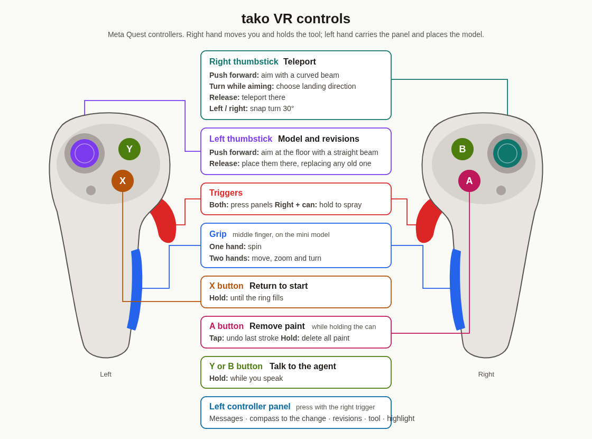
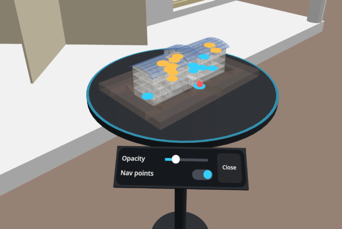
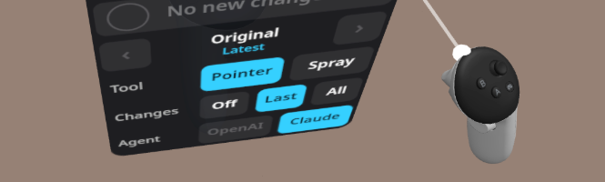
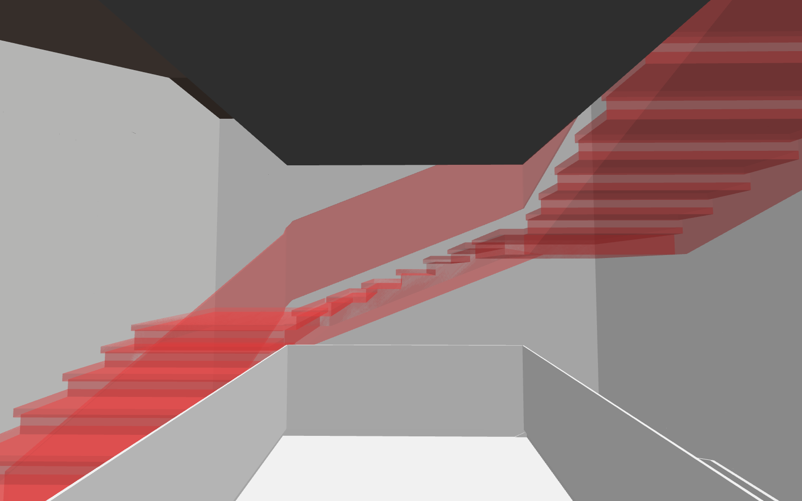
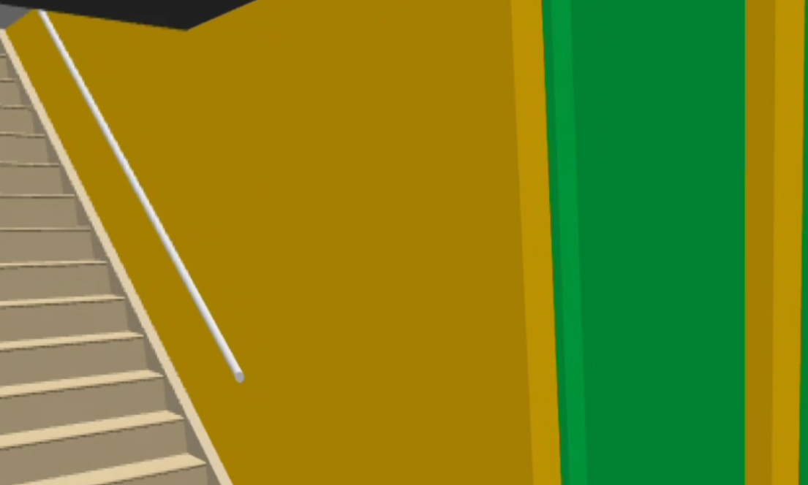
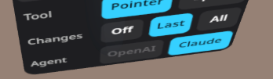
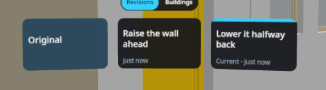
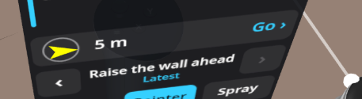

# 🐙 tako: Agentic, Explorative BIM-Editing in VR

**TLDR:** First prototype for walking around and editing IFC files is now online at [tako.koljasam.com/](https://tako.koljasam.com). Open this URL on a VR headset in the browser and try it out.

_If you don't have the password, ask me (Kolja Sam)_.

Here is a demo of me using voice to add a window to a wall:

_the Meta Quest only records the video of one eye, that's why the view looks so narrow and stuff is sometimes out of frame. Sorry for that._

## Goals of the Prototype

1. Allow building engineers to quickly prototype/iterate their designs
2. ~~Allow professors to review student submissions of BIM files~~ (goal for a later version)

## How it Works

1. Building Engineer loads a BIM
2. Building Engineer navigates around the building in VR
3. _optional_: Building Engineer uses the "spray paint" tool to mark features
4. Building Engineer gives a voice instruction of an intended change
5. Voice Instruction is transcribed and passed to an LLM layer, including semantic context of Building Engineer's position and spray-painted marks
6. LLM layer starts an edit-and-revise loop, using tools to read, understand and edit the BIM file
7. Change is displayed in VR

## UX Stuff

First, here are the full controls:

### Movement

You can move around by walking/moving your head. This is usually called _Natural Walking_ in the literature; quite obviously best when you have lots of space, but also doesn't work with stairs etc. Allow me to demonstrate:

{.gif}

You can also teleport by pushing the right thumbstick forward, optionally rotating it (to adjust your target rotation), then letting go. This is very standard stuff, I basically stole the UX flow from the Meta Kit (c.f. [this tutorial](https://www.youtube.com/watch?v=a3ojjAIZCmk)). 

{.gif}

Teleporting this way may take a bit of time to learn how to use it at first; which may be a problem with non-technical users (has to be user-tested). Because teleportation doesn't accelerate or move the user, it reduces cybersickness, but the dicontinuous motion may reduce immersion or spatial understanding, [here](https://www.nature.com/articles/s41598-025-12143-y.pdf) is a decent paper discussing this. This may also be a problem (given that the whole point is spatial understanding of a e.g. a given building), but I'm not sure that we have a reasonable alternative, because continuous joystick movement in a tight virtual space (=house) really does make you rather nauseous.

Related: You can "snap turn" by pushing the right thumbstick right or left. Also very standard, also same tradeoff: little nausea, but possibly spatial confusion:

{.gif}

Last but not least, when pushing your left thumbstick forward, you can place a little model of the building you are in:

You can use this for just looking at the model as a whole, but also by picking one of the teleportation positions to quickly go there. You can rotate and scale the model, change the opacity, and show or hide navigation points. You can also change which BIM file you are looking at in this menu (for now, selected from four models I found on the internet). Here is me interacting with the mini model:

{.gif}

In the literature this is usually called _World-in-Miniature_ ([example](https://dl.acm.org/doi/pdf/10.1145/223904.223938)); but it's also kind of an obvious idea to be honest.

### Editing

I decided to make talking-to-the-agent the _only_ way to change anything about the building.
This is because it is _technically_ feasible to make some _very_ simple edits (e.g. moving a chair) with e.g. controller gestures, we would quickly need very complex logic to handle interdependent elements and support advanced options, and before long we would build a whole AutoDesk competitor in VR (and that's another project for another day :) ).

For editing the building there are some important UI elements on the wrist menu; Bring your left controller up to see it. 

.

Usually, it improves quality when you give the LLM explicit context on what you are referring to by spray-painting it. For that, use your wrist panel to switch the `Tool` from `Pointer` to `Spray`. You can then spray-paint any objects, undo strokes, and delete all strokes (see the controls overview). If you pause spraying for two seconds, a new color will automatically be set. The LLM receives these colors, so you can use this to make different objects different colors and thus give them a clear identity. Then, hold `B` or `Y` to give a task to the LLM. Here is me doing that:

Here is me using three colors to specify the task:

About any edit should be possible, especially if the underlying file is well-made (I'm just not very sure what kind of edits building engineers would like to make). We also have excellent multi-language support, even with bad accents (we just get this for free because frontier LLMs can just do that):

### Revisions & Diffs

An interesting aspect of this project is how to...

1. Allow the building engineer to see and evaluate what changed
2. Allow stakeholders to see and compare and build upon different versions of the BIM

This is a complex problem, especially if this eventually works with multiple people present in VR.
I experimented with some basic stuff, and we will probably need to innovate more here. Here is a quick summary of what exists right now:

Basic green/orange/red overlay materials to indicate what has been added, changed and been deleted:

On the wrist panel, you can choose to see these changes as compared to the original version (`All`), the previous version (`Last`) or not at all (`Off`):

Currently we can undo/redo changes (sort of like in `Microsoft Word`) in a simple linear way (wrist panel, or above the mini menu):

We will probably need a more fancy system later, allowing branching and merging (e.g. "let's go back to the previous change where I moved the opening but integrate the table I added in that other change") — especially when multiple people change things at the same time.

## Tech Stuff

- The code is an open-source repo at [koljapluemer/tako](https://github.com/koljapluemer/tako)
- The algorithm that choses the teleport points in the mini-building is mathematically interesting: It first heuristically finds intersections and unique elements from the BIM ontology, then runs a declustering algorithm to spread them evenly. I really just vibecoded it though.
- How to make the agentic flow fast, cheap and effective is a really interesting question of applied AI engineering (spans RAG, model choice, tool design, prompt engineering, agentic loops, ...). We could use someone with expertise in this field. 
- On the web, the agentic stuff happens via calls to the OpenAI API, when installing the software locally and connecting the VR headset via `adb`, it's also easy to connect the local Claude CLI and save tokens (instructions in repo) 
- Currently, the edits are made with my personal OpenAI API key which is limited to $10 a month, so feel free to play around and give access to trusted people, if you want. Long term, we likely want a better setup for this — @Diah did you say you have a key? :)

## Technical Decisions

- I based the project on the open [IFC format](https://en.wikipedia.org/wiki/Industry_Foundation_Classes) (as opposed to propietary formats). This makes everything easier, faster and more robust. Any serious engineering/architecture CAD tools support exporting to `IFC`, so there shouldn't be any problems
- I implemented the project as a web app, notably without involving `Unity 3D` or any `Meta` software.
  - _Advantages_: Can be simply opened on any XR device with internet, we don't have to send around files. It's fully Open Source (except the used AI frontier models), so there is never going to be any license or cost trouble for users or developers

## Big Problems

Here are the main challenges that I currently see:

1. I got the agent to work sort of fast (10-20 seconds for small changes), and someone with skill could probably make it faster still. Yet, **the LLM is simply inherently slow**. With current frontier models, I don't think changes will actually be *instant* any time soon. This opens a bunch of UX challenges:
    - It feels frustrating/unresponsive, like all slow software systems. We can mitigate that somewhat with stuff like the agent's updates on the wrist panel, but at core, it still feels slow
    - It can be confusing: You can forget what you were working on at the time the agent is done. This is why I added the compass to the wrist panel that shows you *where* the last change was made (in case you walked into another room). But this also doesn't fix the underlying problem. 
    - It can break flow/be boring; It would be tempting to encourage the user to maybe start another task while the agent is working. But this also makes confusion worse, versioning harder, etc.
    - All these problems multiply if it's multiple people triggering multiple agents to work at overlapping times

2. **Missing semantic affordance for expressing optionality, uncertainty and rough ideas:**
   - Looking at building engineer's 2D sketches, I see a lot of marking that seems to indicate stuff like "_maybe_ we want this room to be bigger" or (in a review) "move this opening over here, _or_ over here".
   - I contrast, everything in the world of VR BIM has an exact position, dimension and material — it's _exact_, even if it's "fake exact".
   - There is surprisingly little prior art on this topic (maybe it's a million dollar problem, maybe I'm searching wrong); for example, most architecture software's "sketch modes" ([example](https://docs-chaos.atlassian.net/wiki/spaces/enscape/pages/841908295/Rendering+Styles)) are not even available in 3D (let alone in VR). I'm also really unsure how you would make something that is clearly an optional sketch, _but you can still walk in it in VR_. I want to explore tools like [GravitySketch](https://gravitysketch.com/); maybe they have answers.

## Not Yet Implemented

1. Everything is "singleplayer" for now; it's not possible to be in the same building with multiple people or edit together. Adding multi-player support is not impossible, but work: Some requires time and budget (good server, accounts), some is just features that claude can do (render other people in VR), some UX gets harder (what if two people edit the same wall in a different way). 
2. Currently, you can only look at the random four BIM files I found on the internet and put in. Uploading your own IFC files is technically absolutely no problem, but _getting files onto the VR headset_ is a tedious process in itself. I can't really do anything about that. Idea for now:
    - If you want to look at another IFC file, just send it to me and I will add it to the app
    - Long-term, we implement an online account/cloud system where people can upload files from their work PCs, then login on their VR headset and explore them. Sharing files/editing together etc. is then also easier.
3. For the same reason, it's not yet possible to download/export the changed IFC. Again this is very easy, but then the downloaded file would just be on the VR headset, and you'd need to get it off somehow, which is annoying.